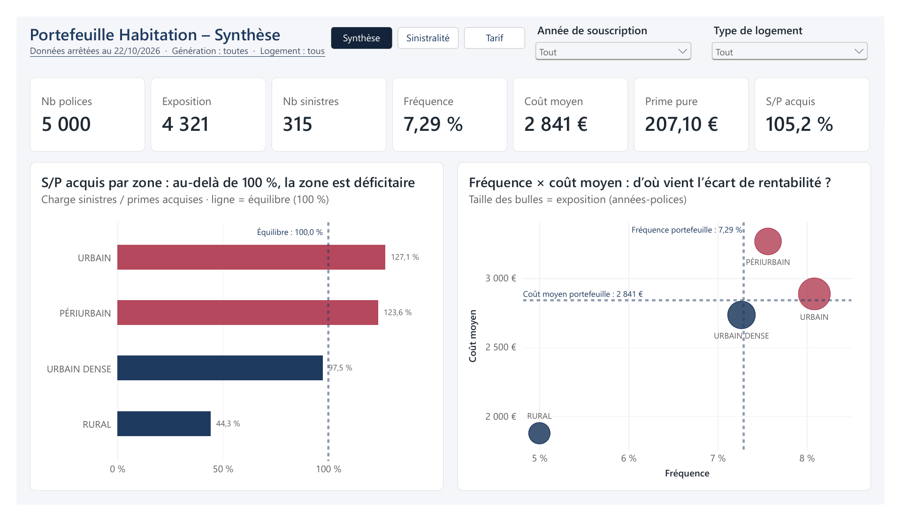
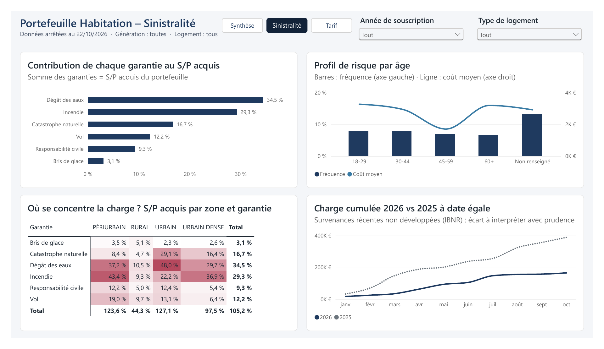
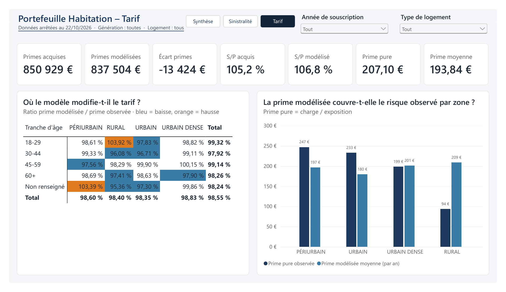
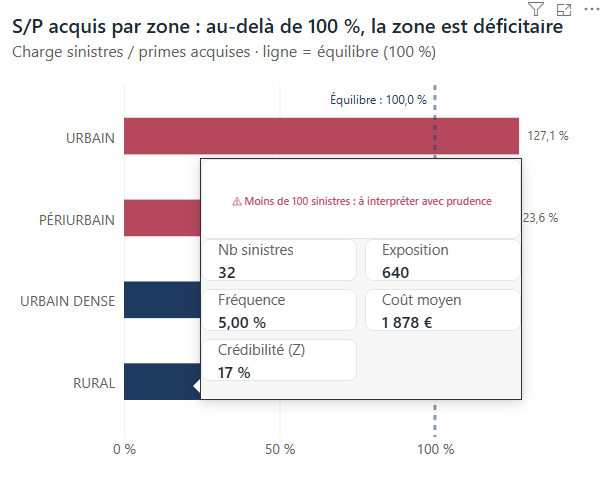
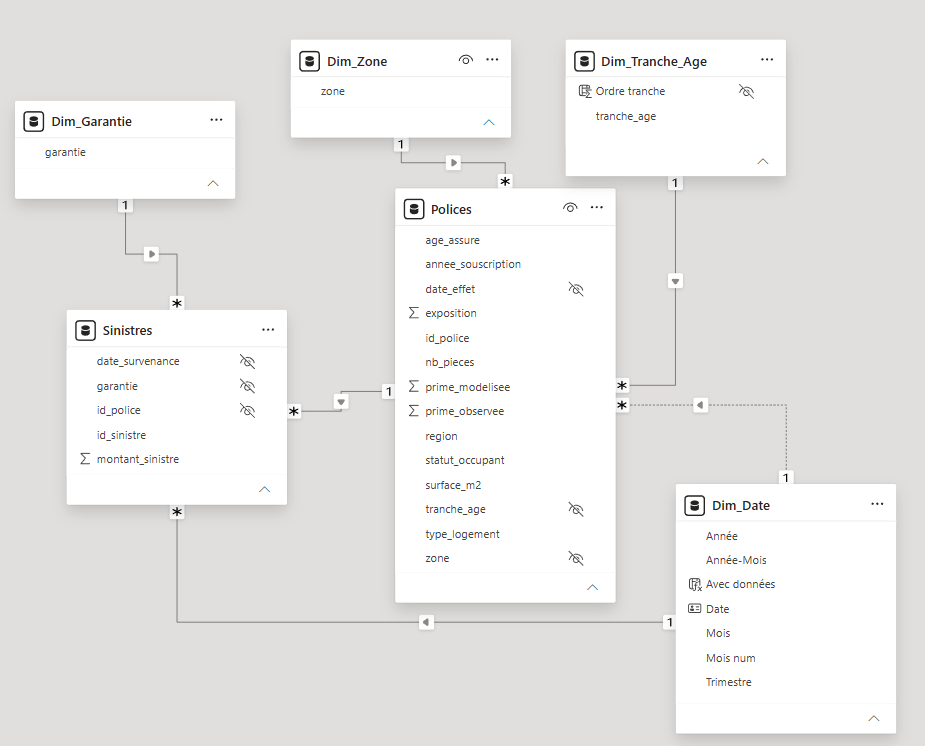

# Tableau de bord Power BI – Sinistralité et tarification d'un portefeuille habitation

Analyse de la rentabilité d'un portefeuille d'assurance habitation (données simulées) et contrôle d'un tarif modélisé, sous la forme d'un rapport Power BI de 3 pages.



## Contexte et objectif

Le portefeuille compte 5 000 contrats souscrits en 2024 et 2025, et 315 sinistres survenus entre février 2024 et le 22/10/2026. Le rapport répond à trois questions :

1. **Le portefeuille est-il rentable, et où se situent les pertes ?** (zones, garanties, tranches d'âge)
2. **D'où vient l'écart de rentabilité : de la fréquence ou du coût moyen des sinistres ?**
3. **Le tarif modélisé corrige-t-il les déséquilibres observés ?**

## Le rapport

| Page | Contenu |
|---|---|
| **Synthèse** | Indicateurs clés (exposition, fréquence, coût moyen, prime pure, S/P acquis), S/P par zone, croisement fréquence × coût moyen |
| **Sinistralité** | Contribution de chaque garantie au S/P, profil de risque par âge, carte de chaleur zone × garantie, charge cumulée 2026 vs 2025 à date égale |
| **Tarif** | Primes observées vs modélisées, ratio prime modélisée / observée par zone et âge, prime pure vs prime modélisée par zone |

<p>
  
  
</p>

Le rapport complet est aussi disponible en PDF : [docs/rapport_tarification_habitation.pdf](docs/rapport_tarification_habitation.pdf).

## Principaux enseignements

- **Le portefeuille est déficitaire avant frais** : S/P acquis de **105,2 %**, pour une fréquence de 7,29 % et un coût moyen de 2 841 €.
- **Les pertes se concentrent en zones urbaine et périurbaine** (S/P de 127 % et 124 %). En Urbain, elles viennent surtout de la **fréquence** (dégâts des eaux : 48 % de S/P) ; en Périurbain, de la **gravité** (coût moyen ≈ 3 300 €, incendie : 43 % de S/P).
- **Le tarif modélisé ne corrige pas ces écarts** : il ne modifie les primes que de −5 % à +4 % et laisse une prime moyenne (194 €) inférieure à la prime pure observée (207 €). On observe une subvention croisée du rural (prime pure 94 €, prime modélisée 209 €) vers l'urbain (233 € vs 180 €), ce qui expose à un risque d'antisélection.
- **Ces écarts doivent être lus avec prudence** : aucune zone n'atteint la pleine crédibilité (voir ci-dessous). Après pondération par la crédibilité, le S/P de l'Urbain reste le plus élevé (≈ 113 %), alors que le Rural se rapproche de l'équilibre (≈ 95 %). La sous-tarification urbaine est donc le signal le plus robuste, la sur-tarification rurale n'est pas démontrée.

**Recommandation** : revoir le zonier en priorité sur l'urbain, en appliquant une pondération de crédibilité aux zones à faible volume.

## Prise en compte de la crédibilité

Une info-bulle affiche, pour chaque zone, le nombre de sinistres et un **facteur de crédibilité de fluctuation limitée** : standard de pleine crédibilité n₀ = (1,645 / 0,05)² ≈ 1 082 sinistres, puis Z = min(1, √(n / n₀)).

| Zone | Sinistres | Z |
|---|---|---|
| Rural | 32 | 17 % |
| Périurbain | 79 | 27 % |
| Urbain dense | 81 | 27 % |
| Urbain | 123 | 34 % |
| Portefeuille | 315 | 54 % |



## Modèle de données



- **Tables de faits** : `Polices` (primes, exposition) et `Sinistres` (montants). `Polices` sert aussi de dimension aux sinistres (zone, âge, type de logement de l'assuré).
- **Dimensions** : `Dim_Zone`, `Dim_Tranche_Age`, `Dim_Garantie` (créées dans Power Query) et `Dim_Date` (créée en DAX, marquée comme table de dates).
- Relations plusieurs-à-un à sens unique. La relation `Polices[date_effet]` → `Dim_Date` est **inactive** et n'est activée qu'à la demande avec `USERELATIONSHIP` pour les analyses par date de souscription.
- Les mesures sont regroupées dans une table `_Mesures` et classées en dossiers (Base, Garanties, Tarif, Temps, Libellés).

## Quelques mesures DAX

```dax
Primes acquises = SUMX ( Polices, Polices[prime_observee] * Polices[exposition] )

S/P acquis = DIVIDE ( [Charge sinistres], [Primes acquises] )

-- S/P d'une garantie rapporté à l'ensemble des primes (somme des garanties = S/P du portefeuille)
S/P acquis garantie =
DIVIDE ( [Charge sinistres], CALCULATE ( [Primes acquises], REMOVEFILTERS ( Dim_Garantie ) ) )

Crédibilité (Z) = MIN ( 1, SQRT ( DIVIDE ( [Nb sinistres], 1082, 0 ) ) )
```

Autres points traités :
- **Comparaison N-1 à date égale** : `SAMEPERIODLASTYEAR` limitée aux dates où des données existent (arrêté au 22/10), pour ne pas comparer 10 mois de 2026 à 12 mois de 2025.
- **Sous-titre dynamique** rappelant la date d'arrêté et les filtres actifs (`ISFILTERED`, `CONCATENATEX`).
- **Biais d'un filtrage bidirectionnel** identifié et évité (relations à sens unique, S/P calculé sur l'ensemble des primes).

L'ensemble des mesures est lisible dans [`report/tarification_habitation.SemanticModel/definition/tables/`](report/tarification_habitation.SemanticModel/definition/tables/).

## Limites

- **Données simulées**, à visée pédagogique.
- **Volumes faibles** : 315 sinistres au total, d'où la pondération par la crédibilité.
- **Survenances récentes non développées** : la charge 2026 est sous-estimée faute de provision pour sinistres tardifs (IBNR), et la baisse observée par rapport à 2025 (−57 % à date égale) est à interpréter avec prudence.
- **S/P calculé avant frais** : il porte sur la prime observée et ne tient pas compte des chargements.

## Structure du dépôt

```
├── data/      polices_habitation.csv, sinistres_habitation.csv
├── docs/      rapport PDF et captures
├── report/    projet Power BI au format PBIP (rapport + modèle sémantique en TMDL)
└── theme/     thème de couleurs (JSON)
```

## Ouvrir le projet

1. Cloner ou télécharger le dépôt.
2. Ouvrir `report/tarification_habitation.pbip` avec **Power BI Desktop** (Windows).
3. Dans *Transformer les données → Modifier les paramètres*, faire pointer `DossierDonnees` vers le dossier `data\` du dépôt (chemin terminé par `\`).
4. Cliquer sur **Actualiser**.

## Outils et compétences

Power BI Desktop · Power Query (nettoyage, dédoublonnage, paramètres) · modélisation en étoile · DAX (CALCULATE, contexte de filtre, USERELATIONSHIP, time intelligence, SUMX) · mise en forme conditionnelle · info-bulles de rapport · navigation · format PBIP / TMDL et versionnement Git

---

**Loïc Bingue** – Master 2 ISEFAR (Statistique du risque), Université Paris Nanterre
